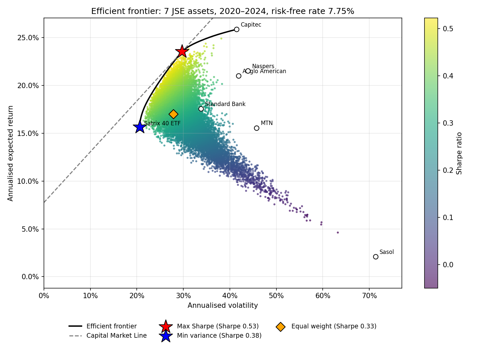
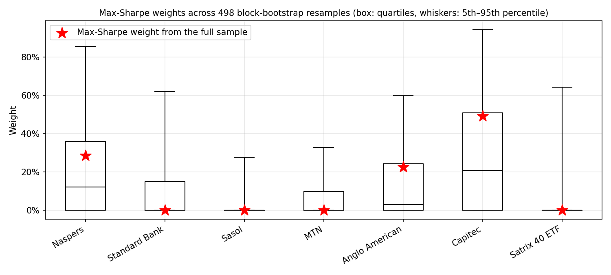
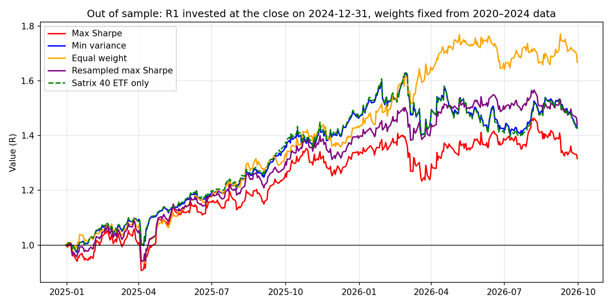
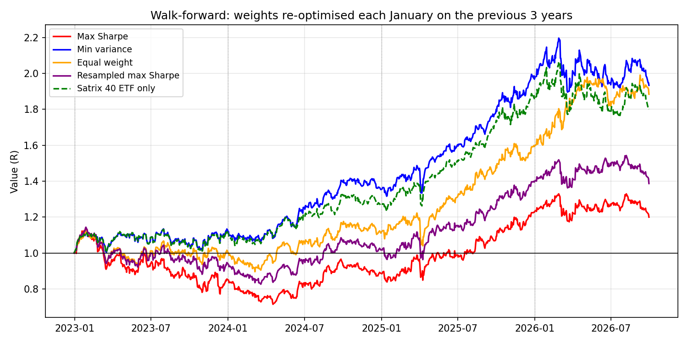

# Portfolio optimisation on the JSE

Mean-variance optimisation of six JSE shares and a Top 40 ETF: the efficient frontier, the maximum-Sharpe and minimum-variance portfolios, a bootstrap check of how stable the optimal weights are, and out-of-sample and walk-forward tests against equal weight and the index.

[](https://github.com/JustinMarshalll/portfolio-optimization/actions/workflows/tests.yml)



## Question

Using daily prices from 2020 to 2024, which long-only mix of these seven assets gave the best return per unit of risk? How much of that answer is noise from one particular five-year sample? And when the weights are held through 2025 and 2026, data the optimiser never saw, do they still beat equal weight and the Top 40 ETF?

## Data

Daily prices from Yahoo Finance via `yfinance`, adjusted for dividends and splits, from 2020-01-01 to 2026-09-30. The first run saves them to `data/prices.csv` so the results can be reproduced.

| Ticker | Company | Sector |
|---|---|---|
| NPN.JO | Naspers | Technology / internet holdings |
| SBK.JO | Standard Bank | Banking |
| SOL.JO | Sasol | Energy and chemicals |
| MTN.JO | MTN | Telecoms |
| AGL.JO | Anglo American | Mining |
| CPI.JO | Capitec | Banking |
| STX40.JO | Satrix 40 ETF | Tracks the FTSE/JSE Top 40 index |

- **Training period:** 2020-01-01 to 2024-12-31. All weights are chosen using this period only.
- **Test period:** 2025-01-01 to 2026-09-30.
- **Risk-free rate:** 7.75%, the SARB repo rate after the 21 November 2024 cut.

## Method

1. Daily simple returns, annualised: mean × 252 and covariance × 252.
2. 20,000 random long-only portfolios with weights drawn from a flat Dirichlet distribution. For each: return $w^\top\mu$, volatility $\sqrt{w^\top\Sigma w}$, Sharpe $(w^\top\mu - r_f)/\sqrt{w^\top\Sigma w}$.
3. `scipy.optimize.minimize` (SLSQP), with weights between 0 and 1 that sum to 1, to find:
   - the **maximum-Sharpe** portfolio,
   - the **minimum-variance** portfolio,
   - the **efficient frontier**, by minimising variance for a grid of target returns.
4. The **Capital Market Line** from the risk-free rate through the maximum-Sharpe portfolio.
5. **Risk contributions:** each asset's share of portfolio variance, $w_i(\Sigma w)_i / w^\top\Sigma w$, next to its share of the money.
6. **Estimation error:** the maximum-Sharpe portfolio re-optimised on 500 moving-block bootstrap resamples of the training returns (21-day blocks), giving a 5th–95th percentile range for every weight. The average of those weights gives a **resampled max-Sharpe** portfolio (Michaud's resampling idea). Plus a check of how the weights change with the risk-free rate (3.5% to 8.25%).
7. **Out-of-sample backtest:** R1 invested in each portfolio at the end of 2024, held without rebalancing, compared with equal weight and the Satrix 40 ETF on return, volatility, Sharpe and maximum drawdown. Each Sharpe ratio comes with an approximate standard error (Lo, 2002).
8. **Walk-forward test:** every January from 2023 to 2026, each method is re-run on the previous three years only and held for a year.

`tests/test_portfolio.py` checks the code against known answers: the closed-form tangency portfolio $w \propto \Sigma^{-1}(\mu - r_f)$ when no weight is negative, the two-asset minimum-variance formula, that the optimisers beat every random portfolio, that risk contributions add up to 1, that the bootstrap keeps its blocks intact and is reproducible, and that the walk-forward test only ever uses past data. GitHub Actions runs the tests on every push.

## Results

All numbers come from `analysis.ipynb` run on the prices in `data/prices.csv` (downloaded 14 October 2026). Returns are annualised, the risk-free rate is 7.75%, and no trading costs are included.

**Training period, 2020–2024**

| Asset | Annual return | Volatility | Sharpe |
|---|---|---|---|
| Capitec | 25.9% | 41.4% | 0.44 |
| Satrix 40 ETF | 15.5% | 20.7% | 0.38 |
| Anglo American | 21.0% | 41.9% | 0.32 |
| Naspers | 21.5% | 43.9% | 0.31 |
| Standard Bank | 17.6% | 33.8% | 0.29 |
| MTN | 15.6% | 45.8% | 0.17 |
| Sasol | 2.1% | 71.3% | -0.08 |

| Portfolio | Expected return | Volatility | Sharpe |
|---|---|---|---|
| Max Sharpe | 23.5% | 29.7% | 0.53 |
| Min variance | 15.7% | 20.6% | 0.38 |
| Equal weight | 17.0% | 27.8% | 0.33 |
| Resampled max Sharpe | 20.4% | 26.4% | 0.48 |

**Weights**

| Asset | Max Sharpe | Min variance | Equal weight | Resampled max Sharpe |
|---|---|---|---|---|
| Naspers | 28.4% | 0.0% | 14.3% | 22.5% |
| Standard Bank | 0.0% | 5.8% | 14.3% | 11.9% |
| Sasol | 0.0% | 0.0% | 14.3% | 4.1% |
| MTN | 0.0% | 0.0% | 14.3% | 7.2% |
| Anglo American | 22.6% | 0.0% | 14.3% | 14.5% |
| Capitec | 49.0% | 0.1% | 14.3% | 29.6% |
| Satrix 40 ETF | 0.0% | 94.1% | 14.3% | 10.2% |

**How stable are the max-Sharpe weights?** (498 usable block-bootstrap resamples; 2 skipped because no asset beat the risk-free rate)

| Asset | Optimal weight | Bootstrap median | 5th percentile | 95th percentile | Resamples holding >1% |
|---|---|---|---|---|---|
| Naspers | 28% | 12% | 0% | 86% | 60% |
| Standard Bank | 0% | 0% | 0% | 62% | 37% |
| Sasol | 0% | 0% | 0% | 28% | 23% |
| MTN | 0% | 0% | 0% | 33% | 38% |
| Anglo American | 23% | 3% | 0% | 60% | 53% |
| Capitec | 49% | 21% | 0% | 94% | 71% |
| Satrix 40 ETF | 0% | 0% | 0% | 64% | 23% |



**Out of sample, 2025-01-02 to 2026-09-30** (weights fixed at the end of 2024, not rebalanced)

| Portfolio | Total return | CAGR | Volatility | Sharpe | Sharpe s.e. | Max drawdown |
|---|---|---|---|---|---|---|
| Max Sharpe | 31.6% | 17.1% | 20.7% | 0.49 | 0.76 | -14.4% |
| Min variance | 42.9% | 22.9% | 17.8% | 0.81 | 0.76 | -13.8% |
| Equal weight | 66.7% | 34.3% | 18.1% | 1.29 | 0.76 | -14.9% |
| Resampled max Sharpe | 44.0% | 23.4% | 17.7% | 0.84 | 0.76 | -13.7% |
| Satrix 40 ETF only | 42.4% | 22.6% | 18.1% | 0.79 | 0.76 | -14.6% |



**Walk-forward, 2023-01-03 to 2026-09-30** (re-optimised each January on the previous three years)

| Portfolio | Total return | CAGR | Volatility | Sharpe | Sharpe s.e. | Max drawdown |
|---|---|---|---|---|---|---|
| Max Sharpe | 20.0% | 5.0% | 21.5% | -0.02 | 0.52 | -37.1% |
| Min variance | 93.4% | 19.5% | 16.5% | 0.69 | 0.52 | -13.7% |
| Equal weight | 88.4% | 18.6% | 18.2% | 0.60 | 0.52 | -20.1% |
| Resampled max Sharpe | 38.7% | 9.2% | 19.3% | 0.15 | 0.52 | -27.7% |
| Satrix 40 ETF only | 80.1% | 17.2% | 16.7% | 0.57 | 0.52 | -14.6% |



Other figures: [price history](figures/prices.png), [correlations](figures/correlation.png), [weights](figures/weights.png), [risk contributions](figures/risk_contributions.png).

## Conclusion

Over 2020–2024 the maximum-Sharpe portfolio had the best risk-adjusted return on paper: a Sharpe ratio of 0.53, with a 23.5% expected return and 29.7% volatility. Equal weight managed 0.33 and the Satrix 40 ETF 0.38. The optimiser put 49% in Capitec, 28% in Naspers and 23% in Anglo American. Capitec had the best Sharpe ratio of the seven assets (0.44), and the three shares moved fairly independently of each other, with pairwise correlations between 0.14 and 0.26. Combining them brought volatility down to about 30%, against more than 40% for each share on its own. Sasol, with a negative Sharpe ratio and 71% volatility, got nothing.

Diversification did more to cut risk than any single choice. The average share had 46% volatility. The minimum-variance portfolio had 20.6%, and it got there by putting 94% in the ETF, which already spreads its money across about 40 shares.

The bootstrap showed that the max-Sharpe weights should not be taken literally. Across 498 resamples Capitec's weight ranged from 0% to 94%, and Anglo American's median weight was 3%. The 95% interval for Capitec's mean return was ±36.5 percentage points, wider than the 25.9% estimate itself.

Out of sample the ranking reversed. From January 2025 to September 2026 the max-Sharpe portfolio had the lowest Sharpe ratio (0.49), behind the ETF (0.79), minimum variance (0.81), the resampled portfolio (0.84) and equal weight (1.29). Naspers lost 16% over that period, while Sasol and MTN, which the optimiser left out, gained 175% and 105%. The walk-forward test from 2023 gave the same result: max Sharpe grew 5.0% a year with a 37% drawdown, against 19.5% for minimum variance and 18.6% for equal weight. The resampled portfolio sat in between. It beat max Sharpe in both tests but trailed minimum variance and equal weight in the walk-forward test.

These gaps should not be over-read. The standard error of a single Sharpe ratio is 0.76 in the out-of-sample test and 0.52 in the walk-forward test, so most of the differences are around one standard error. What the results do show is a consistent pattern: the methods that leaned hardest on estimated mean returns did worst, and the ones that ignored them, minimum variance and equal weight, did best. Five years of JSE data did not pin down mean returns well enough to optimise on.

## Limitations

- Mean returns estimated from five years of data are noisy. Mean-variance optimisation leans heavily on whichever assets did best in the sample, so the weights are unstable and past returns do not predict future ones. The bootstrap and the out-of-sample test measure how much this matters here.
- One constant risk-free rate, for a period in which the repo rate ranged from 3.5% to 8.25%.
- Volatility penalises gains and losses equally, and the Sharpe ratio assumes roughly normal returns. Daily share returns have fatter tails than that.
- No trading costs, taxes or position limits. Portfolios are not rebalanced within a holding period.
- The out-of-sample period is under two years and the walk-forward test under four. The Sharpe standard errors (0.76 and 0.52) are larger than most of the gaps between strategies, so these tests show a pattern but do not prove one strategy is better.
- The block bootstrap keeps short-term volatility clustering but not longer regimes such as the 2020 crash and recovery.
- Seven assets from one market. The ETF holds most of the six shares, so it adds less diversification than a separate asset class would.

## How to run

```bash
git clone https://github.com/JustinMarshalll/portfolio-optimization.git
cd portfolio-optimization
python -m venv .venv
.venv\Scripts\activate          # Windows  (macOS/Linux: source .venv/bin/activate)
pip install -r requirements.txt

python -m pytest                # optional: 16 tests, a few seconds
jupyter notebook analysis.ipynb # then Kernel > Restart Kernel and Run All Cells
```

`data/prices.csv` holds the prices used for the results above, so the notebook reproduces them exactly. Delete that file to download fresh data (results will then change). Everything runs on the CPU in well under a minute; no GPU is needed.

## Repository layout

```
analysis.ipynb          the full analysis, top to bottom
src/portfolio.py        data loading, portfolio maths, optimisers, bootstrap, backtest
tests/test_portfolio.py checks against known closed-form answers
.github/workflows/      runs the tests on GitHub on every push
data/prices.csv         cached prices (created on first run)
figures/                saved charts
```

## What I learned

- An optimiser does exactly what it is asked. It found the best Sharpe ratio for 2020–2024, and that portfolio was the worst performer afterwards, because most of its edge came from noise in the mean returns.
- How wide the uncertainty on a mean return is. Five years of daily data sounds like a lot, but with 40% volatility the 95% interval on the annual mean is still about ±35 percentage points.
- Testing the optimiser against cases with a known answer, such as the closed-form tangency portfolio, made it much easier to trust the code before using it on real data.
- Market data needs checking. JSE prices on Yahoo are quoted in cents, `yfinance` needs scikit-learn to repair bad prices, and the large March 2020 moves had to be looked at before being kept.
- A backtest of under two years cannot really separate strategies. Putting standard errors on the Sharpe ratios made that obvious.
